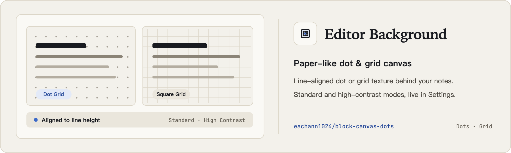

<picture>
  <source media="(prefers-color-scheme: dark)" srcset="assets/card-en-dark.png">
  <source media="(prefers-color-scheme: light)" srcset="assets/card-en-light.png">
  
</picture>

- **Line-aligned**: Dots and grid lines match editor line height to guide your eyes.
- **Contrast presets**: Switch between None, Dots, and Grid with Standard or High Contrast.
- **Instant apply**: Toggle directly from the plugin settings page with one-click Reset Default.

**Install**: Open Block Settings -> App Store and search **Editor Background**, or enter `eachann1024/block-canvas-dots`.
