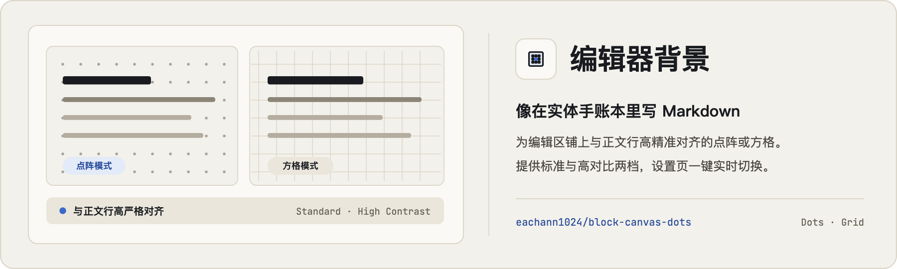

<picture>
  <source media="(prefers-color-scheme: dark)" srcset="assets/card-zh-dark.png">
  <source media="(prefers-color-scheme: light)" srcset="assets/card-zh-light.png">
  
</picture>

- **行高精准对齐**：点阵与方格紧贴正文基线，长文阅读更稳不串行。
- **两档对比度**：支持无 / 点阵 / 方格切换，以及标准 / 高对比调节。
- **实时生效**：在本插件设置页改完立即可见，支持一键恢复默认。

**安装**：打开 Block「设置 → 应用商店」搜索 **编辑器背景**，或手动填入 `eachann1024/block-canvas-dots`。
